Practical 1: My first map
================
Tin Hang (Henry) Hung

- [Your route through the 25
  minutes](#your-route-through-the-25-minutes)
- [Station 0 · Set up](#station-0--set-up)
  - [Packages](#packages)
- [Station 1 · Meet `sf`: the Wytham Woods
  stands](#station-1--meet-sf-the-wytham-woods-stands)
  - [Read the stand polygons](#read-the-stand-polygons)
  - [Inspect](#inspect)
  - [Subset like a data frame](#subset-like-a-data-frame)
- [Station 2 · Map it](#station-2--map-it)
  - [Quick base plots](#quick-base-plots)
  - [A publication-quality map with
    `ggplot2`](#a-publication-quality-map-with-ggplot2)
  - [Choropleth of stand area](#choropleth-of-stand-area)
- [Station 3 · Points in polygons](#station-3--points-in-polygons)
  - [Oak trees as points](#oak-trees-as-points)
  - [Count trees per stand](#count-trees-per-stand)
- [Station 4 · Meet `terra`: WorldClim
  temperature](#station-4--meet-terra-worldclim-temperature)
  - [Read and inspect the raster](#read-and-inspect-the-raster)
  - [Plot, then average the 12 months](#plot-then-average-the-12-months)
- [Station 5 · Crop, mask, aggregate](#station-5--crop-mask-aggregate)
  - [UK boundaries](#uk-boundaries)
  - [Crop and mask](#crop-and-mask)
  - [Aggregate to coarser cells](#aggregate-to-coarser-cells)
- [Station 6 · Raster meets vector](#station-6--raster-meets-vector)
  - [Values at district centroids](#values-at-district-centroids)
  - [Mean temperature per district (zonal
    statistics)](#mean-temperature-per-district-zonal-statistics)
  - [Area-weighted mean (+ optional)](#area-weighted-mean--optional)

In this practical you will handle and visualise **vector** data with
`sf` and **raster** data with `terra`, the two core packages for spatial
data in R.

**Data** (in the `data/` folder next to this file):

| File | Contents |
|----|----|
| `ww/ww.shp` | Wytham Woods stand polygons (WGS 84, EPSG:4326) |
| `oaks.csv` | Oak tree locations (`Sample`, `Latitude`, `Longitude`) |
| `tavg.tif` | WorldClim 2.1 monthly mean temperature, 30 arc-second, UK extent |

⌛ **25 minutes** · practical 1 of 5 in a 2-hour session

# Your route through the 25 minutes

| Station | Minutes | What you do | You leave with |
|----|----|----|----|
| **0** Set up | 0–3 | Packages | A session that runs |
| **1** Meet `sf` | 3–7 | Read, inspect and subset the Wytham Woods stands | A `ww` object you understand |
| **2** Map it | 7–11 | Base plots, a `ggplot2` map, an area choropleth | A publication-style map |
| **3** Points in polygons | 11–15 | CSV to points, count oaks per stand | A map of oaks per stand |
| **4** Meet `terra` | 15–18 | Read and inspect WorldClim temperature | An annual mean temperature layer |
| **5** Crop, mask, aggregate | 18–22 | Clip to the UK and coarsen | A UK-only raster at several resolutions |
| **6** Raster meets vector | 22–25 | Values at points, summaries by polygon | Mean temperature per UK district |

Sections marked **+ optional** can be skipped if you are short of time.

# Station 0 · Set up

⏱️ **0–3 min**

## Packages

``` r
# Install once if needed:
# install.packages(c("sf", "terra", "ggplot2", "dplyr", "units", "rnaturalearth"))
# ne_states() also needs a high-resolution data package that is NOT on CRAN:
# install.packages("rnaturalearthhires", repos = "https://ropensci.r-universe.dev")

library(sf)            # vector data ("simple features")
library(terra)         # raster data (successor to the older 'raster' package)
library(ggplot2)       # plotting; geom_sf() draws sf objects
library(dplyr)         # mutate() and friends
library(units)         # drop_units()
library(rnaturalearth) # country and state boundaries
```

> ✅ **EXPECT TO SEE:** No red errors. Loading `sf` prints its GEOS,
> GDAL and PROJ versions; that is normal.

> 🎉 **MILESTONE!** The two core spatial packages, `sf` and `terra`, are
> loaded.

# Station 1 · Meet `sf`: the Wytham Woods stands

⏱️ **3–7 min**

Wytham Woods is a semi-natural woodland near Oxford and hosts one of the
world’s longest-running ecological studies. Its stands are classified as
`N` (natural), `M` (mixed), `P-E19` (early 19th-century plantation),
`P-M19` (mid 19th-century plantation) and `P-M20` (mid 20th-century
plantation).

## Read the stand polygons

`st_read()` reads any GDAL-supported vector format. Point it at the
`.shp` file; the `.dbf`, `.shx` and `.prj` files must sit next to it.

``` r
ww <- st_read("data/ww/ww.shp", quiet = TRUE)
# GDAL may report "invalid winding order"; it fixes the rings on reading.
```

## Inspect

``` r
ww                 # CRS, bounding box and the first 10 features
```

    ## Simple feature collection with 90 features and 4 fields (with 1 geometry empty)
    ## Geometry type: MULTIPOLYGON
    ## Dimension:     XY
    ## Bounding box:  xmin: -1.34826 ymin: 51.75577 xmax: -1.296902 ymax: 51.78309
    ## Geodetic CRS:  WGS 84
    ## First 10 features:
    ##    id stand       type   area_m2                       geometry
    ## 1   1 P-M19 Plantation 76773.443 MULTIPOLYGON (((-1.32848 51...
    ## 2   2 P-M19 Plantation 89968.805 MULTIPOLYGON (((-1.330548 5...
    ## 3   3     M      Mixed 44994.070 MULTIPOLYGON (((-1.330389 5...
    ## 4   4     M      Mixed 77188.899 MULTIPOLYGON (((-1.334075 5...
    ## 5   4     M      Mixed  2194.656 MULTIPOLYGON (((-1.335598 5...
    ## 6   4 P-M20 Plantation 18590.937 MULTIPOLYGON (((-1.334075 5...
    ## 7   5     M      Mixed  2298.145 MULTIPOLYGON (((-1.3411 51....
    ## 8   5 P-M19 Plantation 80936.459 MULTIPOLYGON (((-1.325292 5...
    ## 9   6     M      Mixed 54657.685 MULTIPOLYGON (((-1.328556 5...
    ## 10  7     M      Mixed 33650.618 MULTIPOLYGON (((-1.333092 5...

``` r
nrow(ww)           # number of features
```

    ## [1] 90

``` r
table(ww$stand)    # number of polygons of each stand type
```

    ## 
    ##     M     N P-E19 P-M19 P-M20 
    ##    46    11     4    11    18

**Question:** how many features does `ww` store?

## Subset like a data frame

``` r
ww[1, ]                                        # first feature (all columns + geometry)
```

    ## Simple feature collection with 1 feature and 4 fields
    ## Geometry type: MULTIPOLYGON
    ## Dimension:     XY
    ## Bounding box:  xmin: -1.32848 ymin: 51.77368 xmax: -1.321138 ymax: 51.77788
    ## Geodetic CRS:  WGS 84
    ##   id stand       type  area_m2                       geometry
    ## 1  1 P-M19 Plantation 76773.44 MULTIPOLYGON (((-1.32848 51...

``` r
ww[ww$stand == "P-M19", ]                      # all mid-19th-century plantation stands
```

    ## Simple feature collection with 11 features and 4 fields
    ## Geometry type: MULTIPOLYGON
    ## Dimension:     XY
    ## Bounding box:  xmin: -1.345264 ymin: 51.76173 xmax: -1.321138 ymax: 51.78026
    ## Geodetic CRS:  WGS 84
    ## First 10 features:
    ##     id stand       type  area_m2                       geometry
    ## 1    1 P-M19 Plantation 76773.44 MULTIPOLYGON (((-1.32848 51...
    ## 2    2 P-M19 Plantation 89968.80 MULTIPOLYGON (((-1.330548 5...
    ## 8    5 P-M19 Plantation 80936.46 MULTIPOLYGON (((-1.325292 5...
    ## 13   9 P-M19 Plantation 38735.18 MULTIPOLYGON (((-1.334546 5...
    ## 17  12 P-M19 Plantation 64263.53 MULTIPOLYGON (((-1.339248 5...
    ## 27  18 P-M19 Plantation 69265.90 MULTIPOLYGON (((-1.34057 51...
    ## 36  22 P-M19 Plantation 40627.98 MULTIPOLYGON (((-1.343492 5...
    ## 42  27 P-M19 Plantation 43820.14 MULTIPOLYGON (((-1.342814 5...
    ## 44  28 P-M19 Plantation 67007.00 MULTIPOLYGON (((-1.337796 5...
    ## 85 501 P-M19 Plantation 40312.71 MULTIPOLYGON (((-1.33536 51...

``` r
ww[ww$stand == "P-M19", "stand"]               # one column; the geometry is "sticky"
```

    ## Simple feature collection with 11 features and 1 field
    ## Geometry type: MULTIPOLYGON
    ## Dimension:     XY
    ## Bounding box:  xmin: -1.345264 ymin: 51.76173 xmax: -1.321138 ymax: 51.78026
    ## Geodetic CRS:  WGS 84
    ## First 10 features:
    ##    stand                       geometry
    ## 1  P-M19 MULTIPOLYGON (((-1.32848 51...
    ## 2  P-M19 MULTIPOLYGON (((-1.330548 5...
    ## 8  P-M19 MULTIPOLYGON (((-1.325292 5...
    ## 13 P-M19 MULTIPOLYGON (((-1.334546 5...
    ## 17 P-M19 MULTIPOLYGON (((-1.339248 5...
    ## 27 P-M19 MULTIPOLYGON (((-1.34057 51...
    ## 36 P-M19 MULTIPOLYGON (((-1.343492 5...
    ## 42 P-M19 MULTIPOLYGON (((-1.342814 5...
    ## 44 P-M19 MULTIPOLYGON (((-1.337796 5...
    ## 85 P-M19 MULTIPOLYGON (((-1.33536 51...

``` r
ww[ww$stand == "P-M19", "stand", drop = TRUE]  # drop = TRUE removes the geometry
```

    ##  [1] "P-M19" "P-M19" "P-M19" "P-M19" "P-M19" "P-M19" "P-M19" "P-M19" "P-M19"
    ## [10] "P-M19" "P-M19"

``` r
st_geometry(ww)[[1]]                           # the geometry of feature 1 (an sfg object)
```

> ✅ **EXPECT TO SEE:** 90 stands (1 with an empty geometry): 46 `M`, 11
> `N`, 4 `P-E19`, 11 `P-M19` and 18 `P-M20`. Geometry type
> `MULTIPOLYGON`, CRS WGS 84.

> 🤔 **THINK IT THROUGH:** why does `ww[, "stand"]` still return a
> geometry column?
>
> *Answer:* geometries in `sf` are “sticky”; use `drop = TRUE` or
> `st_drop_geometry()` for a plain data frame.

> 🎉 **MILESTONE!** You can read a vector file and treat it like a data
> frame, with the geometry carried along.

# Station 2 · Map it

⏱️ **7–11 min**

## Quick base plots

``` r
plot(ww)            # one panel per attribute
```

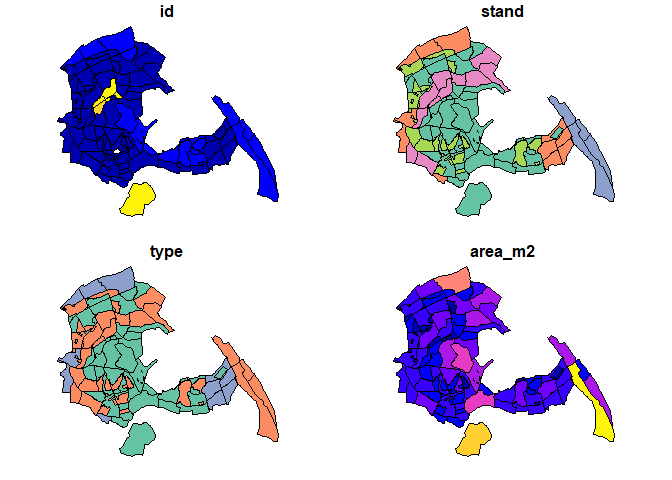<!-- -->

``` r
plot(ww["stand"])   # only the 'stand' attribute
```

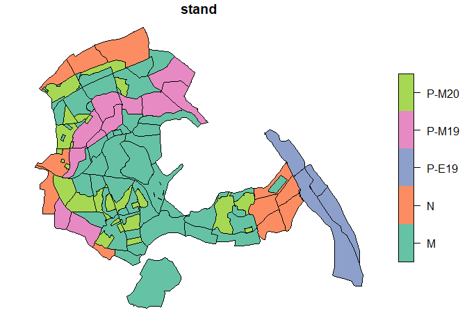<!-- -->

## A publication-quality map with `ggplot2`

`ggplot2` builds a figure layer by layer. `geom_sf()` draws an `sf`
object and `coord_sf()` handles the map projection and graticule.

``` r
ggplot(ww) +
  geom_sf(aes(fill = stand), linewidth = 0.2, colour = "white") +
  coord_sf() +
  labs(title = "Wytham Woods: stands", fill = "Stand type") +
  theme_minimal(base_size = 12) +
  theme(legend.position = "right")
```

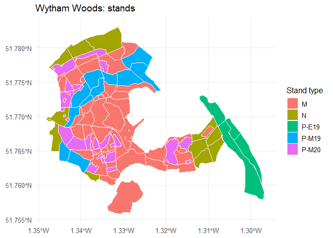<!-- -->

## Choropleth of stand area

`st_area()` returns areas in m² as a `units` object. For
longitude/latitude data `sf` uses the spherical `s2` engine, which is
accurate, so there is no need to switch `s2` off. (`ww` already has an
`area_m2` column; we recompute it to show how.)

``` r
ww <- mutate(ww, area_m2 = st_area(ww))           # e.g. 76773 [m^2]
ww <- mutate(ww, area_m2 = drop_units(area_m2))   # plain numbers for ggplot scales

ggplot(ww) +
  geom_sf(aes(fill = area_m2), colour = "white", linewidth = 0.15) +
  scale_fill_viridis_c(name = expression("Area (m"^2*")"), option = "B") +
  labs(title = "Wytham Woods: stand area") +
  theme_minimal()
```

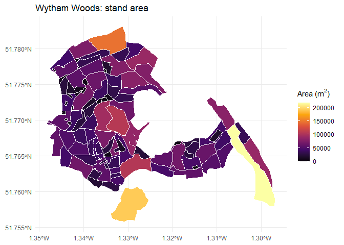<!-- -->

> ✅ **EXPECT TO SEE:** Stand areas up to about 218,000 m² (median about
> 41,000 m²), plus one empty and one 12 m² sliver.

> 🎉 **MILESTONE!** You can make a publication-style map of polygons
> coloured by an attribute.

# Station 3 · Points in polygons

⏱️ **11–15 min**

## Oak trees as points

`st_as_sf()` turns a data frame into points. `coords` is given as
`c(x, y)`, i.e. `c(longitude, latitude)`; the order matters.

``` r
oaks <- read.csv("data/oaks.csv")
oaks <- st_as_sf(oaks, coords = c("Longitude", "Latitude"), crs = 4326)

# Every ggplot layer must be joined with '+'
ggplot() +
  geom_sf(data = ww, aes(fill = stand), linewidth = 0.2, colour = "white") +
  geom_sf(data = oaks, size = 1, alpha = 0.8) +
  coord_sf() +
  labs(title = "Wytham Woods: stands and oaks", fill = "Stand type") +
  theme_minimal(base_size = 12)
```

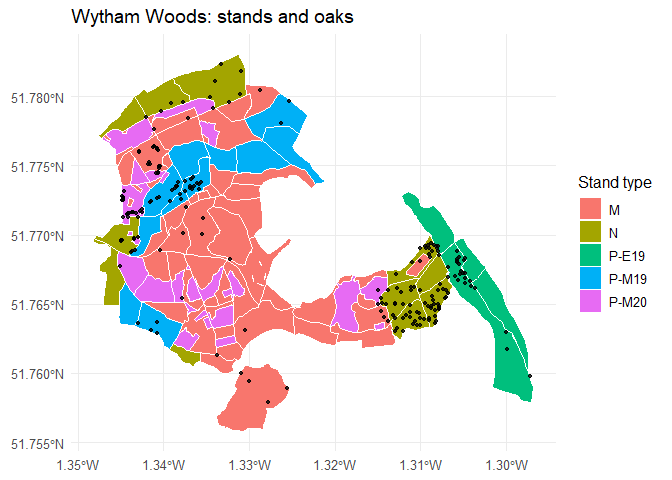<!-- -->

## Count trees per stand

`st_intersects(x, y)` returns, for each feature of `x`, the indices of
the features of `y` that it touches. The result is a list of class
`sgbp` (“sparse geometry binary predicate”), so `lengths()` gives the
counts.

``` r
inter <- st_intersects(ww, oaks)
class(inter)
```

    ## [1] "sgbp" "list"

``` r
ww$n_oaks <- lengths(inter)   # number of oaks in each stand
sum(ww$n_oaks)                # oaks that fall inside a stand
```

    ## [1] 205

``` r
ggplot(ww) +
  geom_sf(aes(fill = n_oaks), colour = "white", linewidth = 0.15) +
  scale_fill_viridis_c(name = "Number of oaks") +
  labs(title = "Wytham Woods: oaks per stand") +
  theme_minimal()
```

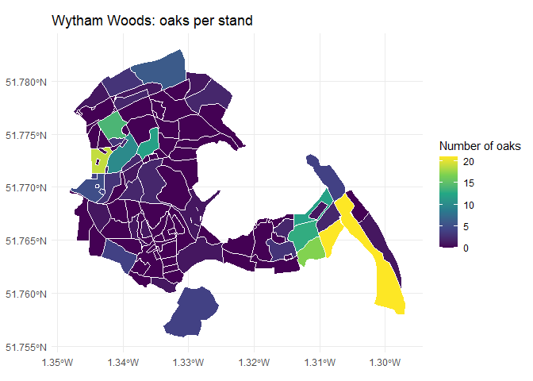<!-- -->

> ✅ **EXPECT TO SEE:** 210 oaks, of which 205 fall inside a stand.

> 🎉 **MILESTONE!** You can turn a table of coordinates into points and
> count them per polygon.

# Station 4 · Meet `terra`: WorldClim temperature

⏱️ **15–18 min**

We use mean monthly temperature for the UK from WorldClim.

> **Tip:** `geodata` can download WorldClim directly. `res = 0.5` gives
> the same 30 arc-second grid as `tavg.tif` (`res = 2.5` is a coarser
> 2.5 arc-minute grid).
>
> ``` r
> tavg <- geodata::worldclim_country(country = "United Kingdom", var = "tavg",
>                                    res = 0.5, path = ".")
> ```

## Read and inspect the raster

``` r
tavg <- rast("data/tavg.tif")   # a SpatRaster with 12 layers, one per month
ww_v <- vect(ww)                # terra's vector class (SpatVector)

class(tavg); class(ww_v)
```

    ## [1] "SpatRaster"
    ## attr(,"package")
    ## [1] "terra"

    ## [1] "SpatVector"
    ## attr(,"package")
    ## [1] "terra"

``` r
res(tavg)                       # cell size in degrees (0.00833 deg = 30 arc-seconds)
```

    ## [1] 0.008333333 0.008333333

``` r
ext(tavg)                       # extent: xmin, xmax, ymin, ymax
```

    ## SpatExtent : -14, 2, 49.5, 62 (xmin, xmax, ymin, ymax)

``` r
crs(tavg, describe = TRUE)      # WGS 84 (EPSG:4326)
```

    ##     name authority code  area             extent
    ## 1 WGS 84      EPSG 4326 World -180, 180, -90, 90

``` r
summary(ww_v)
```

    ##        id            stand               type              area_m2      
    ##  Min.   :  1.00   Length:90          Length:90          Min.   :     0  
    ##  1st Qu.: 16.00   Class :character   Class :character   1st Qu.: 23665  
    ##  Median : 29.00   Mode  :character   Mode  :character   Median : 41316  
    ##  Mean   : 61.69                                         Mean   : 46072  
    ##  3rd Qu.: 55.00                                         3rd Qu.: 58067  
    ##  Max.   :510.00                                         Max.   :217828  
    ##  NA's   :1                                                              
    ##      n_oaks      
    ##  Min.   : 0.000  
    ##  1st Qu.: 0.000  
    ##  Median : 0.000  
    ##  Mean   : 2.278  
    ##  3rd Qu.: 2.000  
    ##  Max.   :21.000  
    ## 

## Plot, then average the 12 months

``` r
plot(tavg)                      # 12 panels
```

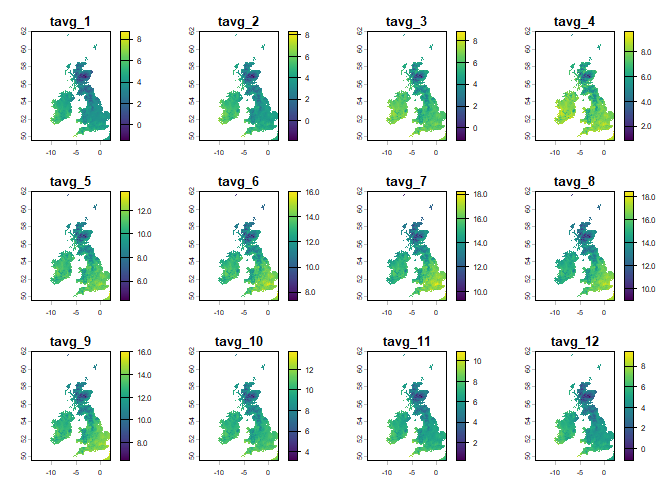<!-- -->

``` r
tavg.ann <- mean(tavg)          # cell-wise mean across layers -> one layer named "mean"
plot(tavg.ann)
```

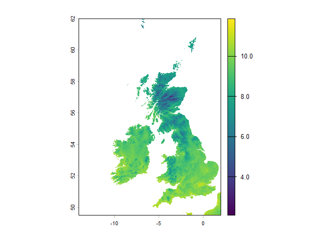<!-- -->

> ✅ **EXPECT TO SEE:** `tavg` has 1500 × 1920 cells and 12 layers, cell
> size 0.00833°, extent −14 to 2 °E and 49.5 to 62 °N.

> 🎉 **MILESTONE!** You can read a multi-layer raster and summarise it
> across layers.

# Station 5 · Crop, mask, aggregate

⏱️ **18–22 min**

## UK boundaries

``` r
uk <- ne_states("United Kingdom", returnclass = "sf")   # needs rnaturalearthhires
ggplot(uk) + geom_sf() + theme_minimal()
```

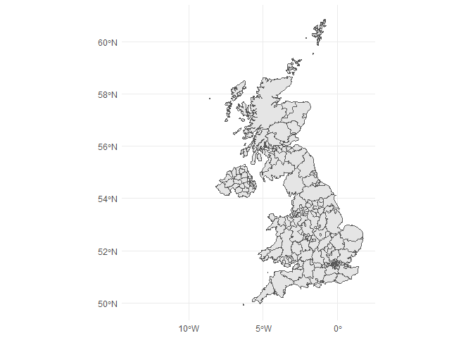<!-- -->

## Crop and mask

`crop()` cuts the raster to a bounding box; `mask()` then sets every
cell outside the polygons to `NA` (removing, for example, the bit of
France).

``` r
tavg.ann <- crop(tavg.ann, ext(uk))
tavg.ann <- mask(tavg.ann, vect(uk))
plot(tavg.ann)
```

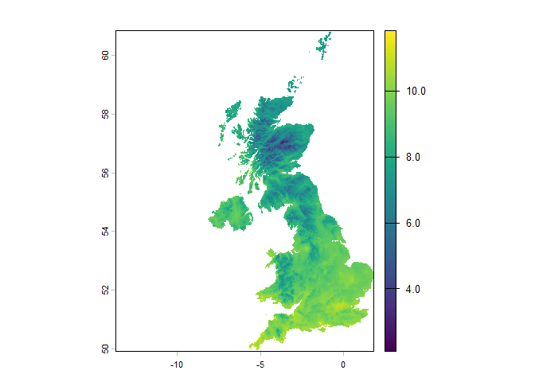<!-- -->

## Aggregate to coarser cells

`fact` is the number of cells to merge. One number applies to both
directions; two numbers are `c(rows, columns)`, i.e. vertical then
horizontal.

``` r
a <- aggregate(tavg.ann, fact = 10,       fun = "mean", na.rm = TRUE)  # 10 x 10 blocks
b <- aggregate(tavg.ann, fact = 50,       fun = "mean", na.rm = TRUE)  # 50 x 50 blocks
c <- aggregate(tavg.ann, fact = c(50, 1), fun = "mean", na.rm = TRUE)  # tall, thin cells
d <- aggregate(tavg.ann, fact = 10,       fun = "max",  na.rm = TRUE)  # maximum, not mean

par(mfrow = c(2, 2))
plot(a, main = "mean, fact = 10"); plot(b, main = "mean, fact = 50")
plot(c, main = "mean, fact = c(50, 1)"); plot(d, main = "max, fact = 10")
```

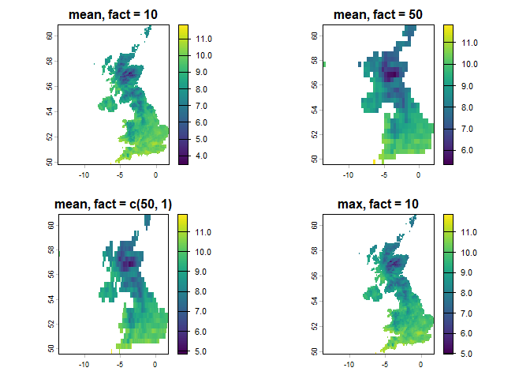<!-- -->

``` r
par(mfrow = c(1, 1))
```

> ✅ **EXPECT TO SEE:** Only the UK is coloured, from about 2 °C on the
> Scottish mountains to about 12 °C in the south-west. `res(c)` is about
> 0.0083° wide and 0.42° tall.

> 🎉 **MILESTONE!** You can clip a raster to a study area and change its
> resolution.

# Station 6 · Raster meets vector

⏱️ **22–25 min**

## Values at district centroids

``` r
uk_v <- vect(uk)                       # SpatVector version of uk
cent <- crds(centroids(uk_v))          # matrix of centroid x/y coordinates

plot(tavg.ann); plot(uk_v, add = TRUE); points(cent, pch = 16, cex = 0.4)
```

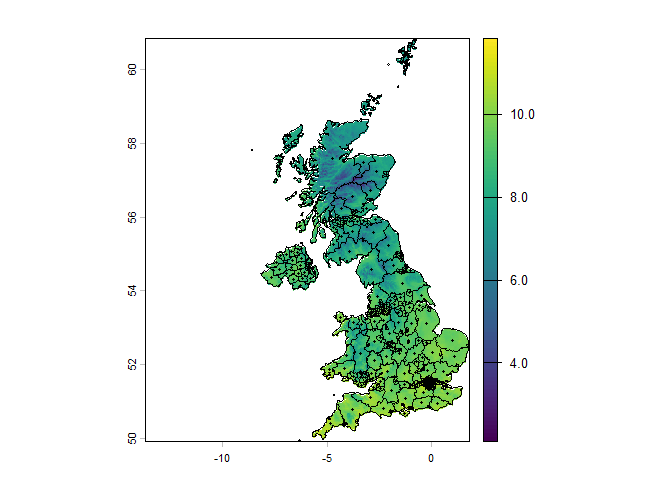<!-- -->

``` r
tavg.cent <- extract(tavg.ann, as.data.frame(cent))   # columns: ID, mean
tavg.cent <- cbind(as.data.frame(cent), tavg.cent)
head(tavg.cent)
```

    ##           x        y ID     mean
    ## 1 -7.214693 54.94566  1 9.100000
    ## 2 -7.430977 54.75913  2 9.383333
    ## 3 -7.645654 54.34870  3 9.633333
    ## 4 -6.930969 54.45665  4 9.033333
    ## 5 -6.629611 54.32026  5 9.125000
    ## 6 -6.290144 54.15275  6 9.241667

## Mean temperature per district (zonal statistics)

`extract()` with polygons returns a data frame: column 1 is the polygon
`ID`, column 2 the summarised layer. We use `[, 2]` rather than `$mean`,
because the column is named after the layer and would change if the
layer were renamed.

``` r
uk$tavg.ann <- extract(tavg.ann, uk_v, fun = mean, na.rm = TRUE)[, 2]

ggplot(uk) +
  geom_sf(aes(fill = tavg.ann), colour = NA) +
  scale_fill_viridis_c(name = "Mean annual\ntemperature (°C)") +
  theme_minimal()
```

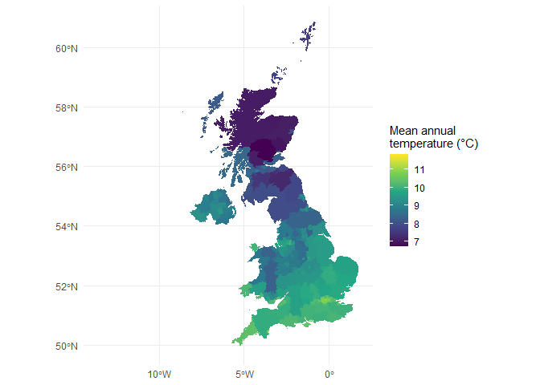<!-- -->

## Area-weighted mean (+ optional)

`weights = TRUE` weights each cell by the fraction of it that lies
inside the polygon.

``` r
uk$tavg.ann.weighted <- extract(tavg.ann, uk_v, fun = mean,
                                weights = TRUE, na.rm = TRUE)[, 2]
summary(uk$tavg.ann.weighted - uk$tavg.ann)   # tiny differences at this resolution
```

    ##       Min.    1st Qu.     Median       Mean    3rd Qu.       Max. 
    ## -0.0168421 -0.0014256 -0.0001210 -0.0002052  0.0009738  0.0086572

**Question:** why are the weighted and unweighted means so similar here?
When would they differ more?

> ✅ **EXPECT TO SEE:** Weighted and unweighted district means differ by
> less than 0.02 °C.

> 🎉 **MILESTONE!** You can move information between rasters and
> vectors: values at points and summaries over polygons.

------------------------------------------------------------------------

**Congratulations!** You can now read, manipulate and map vector and
raster data with `sf` and `terra`.
