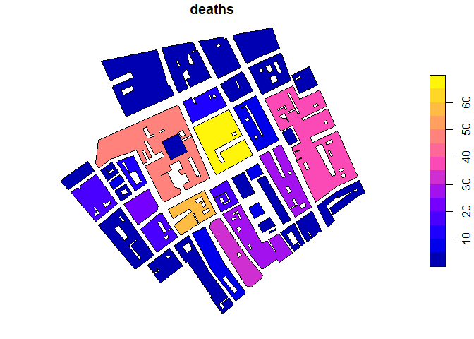
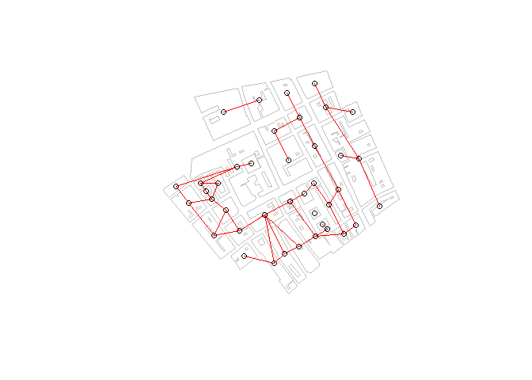
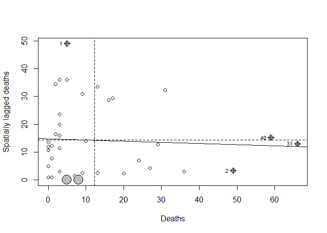
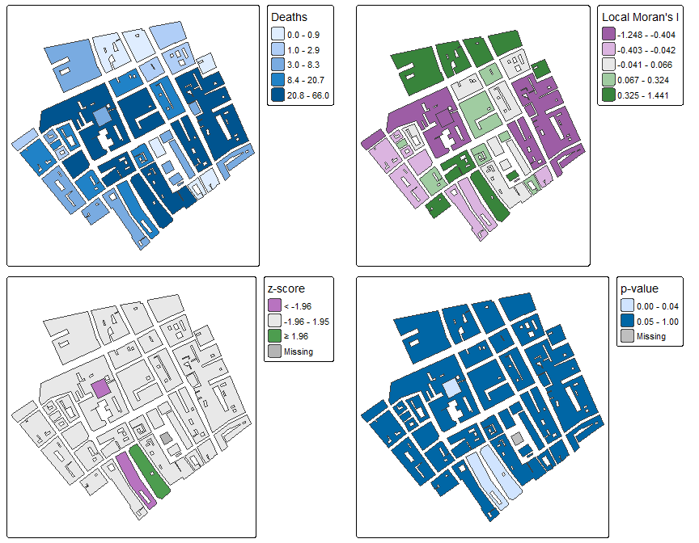
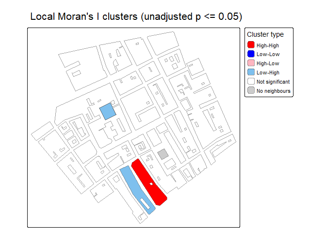

Practical 2: Spatial autocorrelation
================
Tin Hang (Henry) Hung

- [Your route through the 25
  minutes](#your-route-through-the-25-minutes)
- [Station 0 · Set up](#station-0--set-up)
  - [Packages](#packages)
  - [Load the data and check the CRS](#load-the-data-and-check-the-crs)
- [Station 1 · Who is my neighbour?](#station-1--who-is-my-neighbour)
- [Station 2 · Global Moran’s I](#station-2--global-morans-i)
  - [How much does the choice of W matter? (+
    optional)](#how-much-does-the-choice-of-w-matter--optional)
  - [Moran scatterplot](#moran-scatterplot)
- [Station 3 · Local Moran’s I](#station-3--local-morans-i)
- [Station 4 · Map the local
  statistics](#station-4--map-the-local-statistics)
- [Station 5 · Cluster map](#station-5--cluster-map)

We revisit John Snow’s analysis of the 1854 Soho cholera outbreak (his
map was published in 1855). Do neighbouring housing blocks have similar
numbers of deaths? Clustering would point to a local, shared cause.

**Data:** `data/snow/snow.shp`, 40 housing-block polygons in British
National Grid (metres), with `deaths` (count) and `deathdens` (deaths
per unit area).

⌛ **25 minutes** · practical 2 of 5 in a 2-hour session

# Your route through the 25 minutes

| Station | Minutes | What you do | You leave with |
|----|----|----|----|
| **0** Set up | 0–3 | Packages, data, check the CRS | A `snow` object you can trust |
| **1** Who is my neighbour? | 3–9 | `poly2nb()`, fix the error, make weights | A spatial weights list |
| **2** Global Moran’s I | 9–13 | `moran.test()`, `moran.mc()`, the Moran scatterplot | One number for the whole map |
| **3** Local Moran’s I | 13–17 | `localmoran()`, multiple testing | A local I, z-score and p-value per block |
| **4** Map the local statistics | 17–21 | Four `tmap` maps side by side | A panel of maps |
| **5** Cluster map | 21–25 | High-High, Low-Low, … | A LISA cluster map |

Sections marked **+ optional** can be skipped if you are short of time.

# Station 0 · Set up

⏱️ **0–3 min**

## Packages

``` r
# install.packages(c("sf", "spdep", "tmap"))   # tmap >= 4.0
library(sf)
library(spdep)   # neighbours, spatial weights, Moran's I
library(tmap)    # thematic maps
```

## Load the data and check the CRS

``` r
snow <- st_read("data/snow/snow.shp", quiet = TRUE)
st_crs(snow)$units   # metres
```

    ## [1] "m"

The CRS prints as “Transverse_Mercator”, but its parameters are those of
the British National Grid and its units are **metres**. That is what we
want for distance-based operations such as snapping or buffering, so we
do **not** transform to longitude/latitude (EPSG:4326, degrees). We just
give it its proper EPSG code:

``` r
st_crs(snow) <- 27700   # same parameters, now labelled as EPSG:27700
```

``` r
plot(snow["deaths"])
```

<!-- -->

``` r
summary(snow$deaths)                    # 0 to 66 deaths per block
```

    ##    Min. 1st Qu.  Median    Mean 3rd Qu.    Max. 
    ##    0.00    2.00    5.00   12.22   16.25   66.00

``` r
summary(as.numeric(st_area(snow)))      # block areas in m^2
```

    ##     Min.  1st Qu.   Median     Mean  3rd Qu.     Max. 
    ##    43.32  1172.43  2340.20  3120.61  3742.77 15034.30

**Question:** the blocks differ about 350-fold in area. What does that
mean for comparing raw death counts?

> ✅ **EXPECT TO SEE:** 40 housing blocks; deaths range from 0 to 66
> (median 5, mean about 12).

> 🎉 **MILESTONE!** The outbreak data are loaded, in metres, with their
> proper EPSG code.

# Station 1 · Who is my neighbour?

⏱️ **3–9 min**

`poly2nb()` calls two polygons neighbours when their **boundaries share
at least one point** (queen) or a whole edge (rook), within a tiny snap
tolerance.

``` r
snow.nb <- poly2nb(snow, queen = TRUE)
snow.nb
```

    ## Neighbour list object:
    ## Number of regions: 40 
    ## Number of nonzero links: 2 
    ## Percentage nonzero weights: 0.125 
    ## Average number of links: 0.05 
    ## 38 regions with no links:
    ## 3, 4, 5, 6, 7, 8, 9, 10, 11, 12, 13, 14, 15, 16, 17, 18, 19, 20, 21,
    ## 22, 23, 24, 25, 26, 27, 28, 29, 30, 31, 32, 33, 34, 35, 36, 37, 38, 39,
    ## 40
    ## 39 disjoint connected subgraphs

``` r
nb2listw(snow.nb, style = "W")    # error: empty neighbour sets
```

    ## Error in `nb2listw()`:
    ## ! Empty neighbour sets found (zero.policy: FALSE)

**Why the error?** The polygons are housing blocks separated by streets,
so no two boundaries touch and every block has zero neighbours.

**Fix:** let boundaries within 10 m of each other (about one street
width) count as touching, using `snap` (in CRS units, here metres).

> Buffering the blocks with `st_buffer()` and then calling `poly2nb()`
> does *not* work well: the buffered blocks overlap, but `poly2nb()`
> looks for shared boundary points, and overlapping polygons with
> crossing edges often share none.

``` r
snow.nb <- poly2nb(snow, queen = TRUE, snap = 10)
snow.nb   # how many links? any blocks still without neighbours?
```

    ## Neighbour list object:
    ## Number of regions: 40 
    ## Number of nonzero links: 90 
    ## Percentage nonzero weights: 5.625 
    ## Average number of links: 2.25 
    ## 1 region with no links:
    ## 11
    ## 4 disjoint connected subgraphs

``` r
cent <- st_coordinates(st_centroid(st_geometry(snow)))
plot(st_geometry(snow), border = "grey")
plot(snow.nb, cent, add = TRUE, col = "red")
```

<!-- -->

Row-standardised weights (`style = "W"`): each row of $W$ sums to 1, so
a block’s spatial lag is the mean of its neighbours.
`zero.policy = TRUE` keeps blocks without neighbours (their row of $W$
is all zeros).

``` r
snow.nbw <- nb2listw(snow.nb, style = "W", zero.policy = TRUE)
```

> ✅ **EXPECT TO SEE:** First an error from `nb2listw()`: all 40 blocks
> have no neighbours. With `snap = 10`: 90 links (2.25 per block) and 1
> block without neighbours.

> 🎉 **MILESTONE!** You have a spatial weights list, the ingredient
> every spatial autocorrelation statistic needs.

# Station 2 · Global Moran’s I

⏱️ **9–13 min**

`moran.test()` uses the variance under the **randomisation** assumption
by default and a one-sided alternative ($I > E[I]$).

``` r
snow.gi <- moran.test(snow$deaths, snow.nbw, zero.policy = TRUE)
snow.gi
```

    ## 
    ##  Moran I test under randomisation
    ## 
    ## data:  snow$deaths  
    ## weights: snow.nbw  
    ## n reduced by no-neighbour observations  
    ## 
    ## Moran I statistic standard deviate = -0.13972, p-value = 0.5556
    ## alternative hypothesis: greater
    ## sample estimates:
    ## Moran I statistic       Expectation          Variance 
    ##       -0.04702609       -0.02631579        0.02197222

A permutation (Monte Carlo) test makes no distributional assumption:

``` r
set.seed(1)
moran.mc(snow$deaths, snow.nbw, nsim = 999, zero.policy = TRUE)
```

    ## 
    ##  Monte-Carlo simulation of Moran I
    ## 
    ## data:  snow$deaths 
    ## weights: snow.nbw  
    ## number of simulations + 1: 1000 
    ## 
    ## statistic = -0.047026, observed rank = 468, p-value = 0.532
    ## alternative hypothesis: greater

**Question:** compare $I$ with $E[I] = -1/(n-1)$. Is there evidence of
global spatial autocorrelation in death counts at the scale of housing
blocks?

The death **rate** removes the effect of block size:

``` r
moran.test(snow$deathdens, snow.nbw, zero.policy = TRUE)
```

    ## 
    ##  Moran I test under randomisation
    ## 
    ## data:  snow$deathdens  
    ## weights: snow.nbw  
    ## n reduced by no-neighbour observations  
    ## 
    ## Moran I statistic standard deviate = 0.50242, p-value = 0.3077
    ## alternative hypothesis: greater
    ## sample estimates:
    ## Moran I statistic       Expectation          Variance 
    ##        0.02508595       -0.02631579        0.01046691

## How much does the choice of W matter? (+ optional)

Moran’s I is only defined relative to a weights matrix. Here we compare
several reasonable definitions of “neighbour”.

``` r
moran_for <- function(nb, y = snow$deaths) {
  lw <- nb2listw(nb, style = "W", zero.policy = TRUE)
  mt <- moran.test(y, lw, zero.policy = TRUE)
  c(links = sum(card(nb)), isolated = sum(card(nb) == 0),
    I = unname(mt$estimate[1]), p = mt$p.value)
}

# True overlaps of 5 m buffers (computed in metres), via st_intersects()
overlap <- st_intersects(st_buffer(snow, 5))
nb.overlap <- lapply(seq_along(overlap), function(i) {
  j <- setdiff(overlap[[i]], i); if (length(j) == 0) 0L else as.integer(j)
})
attributes(nb.overlap) <- attributes(snow.nb)

# Buffering after transforming to lon/lat: st_buffer() then works on the sphere
nb.lonlat <- poly2nb(st_buffer(st_transform(snow, 4326), 5))

rbind(
  "snap 5 m"                      = moran_for(poly2nb(snow, snap = 5)),
  "snap 10 m"                     = moran_for(snow.nb),
  "snap 12 m"                     = moran_for(poly2nb(snow, snap = 12)),
  "5 m buffers overlap"           = moran_for(nb.overlap),
  "5 m buffer in EPSG:4326"       = moran_for(nb.lonlat),
  "k = 4 nearest centroids"       = moran_for(knn2nb(knearneigh(cent, k = 4)))
) |> round(3)
```

    ##                         links isolated      I     p
    ## snap 5 m                   16       27 -0.052 0.454
    ## snap 10 m                  90        1 -0.047 0.556
    ## snap 12 m                 136        1  0.136 0.090
    ## 5 m buffers overlap       116        0  0.049 0.286
    ## 5 m buffer in EPSG:4326   124        2  0.215 0.025
    ## k = 4 nearest centroids   160        0  0.026 0.288

**Question:** which conclusion is robust to the definition of $W$, and
which is not? What would you report?

## Moran scatterplot

Each block’s value (x-axis) against its spatial lag, the weighted mean
of its neighbours (y-axis). With row-standardised weights, the slope of
the fitted line equals global Moran’s I.

``` r
moran.plot(snow$deaths, snow.nbw, zero.policy = TRUE,
           xlab = "Deaths", ylab = "Spatially lagged deaths")
```

<!-- -->

> ✅ **EXPECT TO SEE:** For deaths, I ≈ −0.047 against E\[I\] ≈ −0.026,
> p ≈ 0.56. The table shows the answer changes with the choice of W.

> 🎉 **MILESTONE!** You can summarise the spatial autocorrelation of a
> whole map and check how robust it is.

# Station 3 · Local Moran’s I

⏱️ **13–17 min**

``` r
snow.li <- localmoran(snow$deaths, snow.nbw, zero.policy = TRUE)
head(snow.li)
```

    ##            Ii         E.Ii    Var.Ii        Z.Ii Pr(z != E(Ii))
    ## 1 -1.01421895 -0.005109193 0.2033236 -2.23792000     0.02522627
    ## 2 -1.24817949 -0.132367676 1.4506923 -0.92641014     0.35423287
    ## 3  1.44111025 -0.034501380 0.4207710  2.27483125     0.02291605
    ## 4  0.03361731 -0.027542391 0.2466930  0.12313656     0.90199896
    ## 5  0.07271942 -0.014627642 0.1820675  0.20470674     0.83780125
    ## 6 -0.05949771 -0.014627642 0.2806873 -0.08469257     0.93250580

Columns: `Ii` (local I), `E.Ii`, `Var.Ii`, `Z.Ii` (z-score) and the
p-value. We extract by position, because the p-value column name changes
with the `alternative` argument (e.g. `Pr(z != E(Ii))` vs
`Pr(z > E(Ii))`).

``` r
snow$li <- snow.li[, 1]   # Ii
snow$lz <- snow.li[, 4]   # Z.Ii
snow$lp <- snow.li[, 5]   # p-value
```

With 40 local tests, some will look “significant” by chance:

``` r
sum(snow$lp <= 0.05, na.rm = TRUE)                              # unadjusted
```

    ## [1] 3

``` r
sum(p.adjust(snow$lp, method = "BH") <= 0.05, na.rm = TRUE)     # false discovery rate
```

    ## [1] 0

> ✅ **EXPECT TO SEE:** 3 blocks with unadjusted p ≤ 0.05, and none
> after the Benjamini-Hochberg adjustment.

> 🎉 **MILESTONE!** You have a local statistic, z-score and p-value for
> every block.

# Station 4 · Map the local statistics

⏱️ **17–21 min**

``` r
tmap_mode("plot")   # use "view" for interactive maps

p.deaths <- tm_shape(snow) +
  tm_polygons(fill = "deaths",
              fill.scale  = tm_scale_intervals(style = "quantile"),
              fill.legend = tm_legend(title = "Deaths"))

p.i <- tm_shape(snow) +
  tm_polygons(fill = "li",
              fill.scale  = tm_scale_intervals(style = "quantile"),
              fill.legend = tm_legend(title = "Local Moran's I"))

p.z <- tm_shape(snow) +
  tm_polygons(fill = "lz",
              fill.scale  = tm_scale_intervals(breaks = c(-Inf, -1.96, 1.96, Inf)),
              fill.legend = tm_legend(title = "z-score"))

p.p <- tm_shape(snow) +
  tm_polygons(fill = "lp",
              fill.scale  = tm_scale_intervals(breaks = c(0, 0.05, 1)),
              fill.legend = tm_legend(title = "p-value"))

tmap_arrange(p.deaths, p.i, p.z, p.p)
```

<!-- -->

> ✅ **EXPECT TO SEE:** A 2 × 2 panel of maps.

> 🎉 **MILESTONE!** You can put several thematic maps side by side.

# Station 5 · Cluster map

⏱️ **21–25 min**

Standardise deaths so that 0 is the mean; `wx` is the spatial lag of the
standardised values. The sign of each tells us the quadrant.

``` r
snow.mp <- moran.plot(as.vector(scale(snow$deaths)), snow.nbw,
                      zero.policy = TRUE, plot = FALSE)

sig <- !is.na(snow$lp) & snow$lp <= 0.05
snow$quadrant <- "Not significant"
snow$quadrant[sig & snow.mp$x > 0 & snow.mp$wx > 0] <- "High-High"
snow$quadrant[sig & snow.mp$x < 0 & snow.mp$wx < 0] <- "Low-Low"
snow$quadrant[sig & snow.mp$x > 0 & snow.mp$wx < 0] <- "High-Low"
snow$quadrant[sig & snow.mp$x < 0 & snow.mp$wx > 0] <- "Low-High"
snow$quadrant[is.na(snow$lp)] <- "No neighbours"
snow$quadrant <- factor(snow$quadrant,
  levels = c("High-High", "Low-Low", "High-Low", "Low-High",
             "Not significant", "No neighbours"))
table(snow$quadrant)
```

    ## 
    ##       High-High         Low-Low        High-Low        Low-High Not significant 
    ##               1               0               0               2              36 
    ##   No neighbours 
    ##               1

``` r
# spdep also returns this classification directly: attr(snow.li, "quadr")$mean
```

``` r
tm_shape(snow) +
  tm_polygons(fill = "quadrant",
              fill.scale = tm_scale_categorical(
                values = c("red", "blue", "lightpink", "skyblue2", "white", "grey80")),
              fill.legend = tm_legend(title = "Cluster type"),
              col_alpha = 0.5) +
  tm_title("Local Moran's I clusters (unadjusted p <= 0.05)")
```

<!-- -->

> ✅ **EXPECT TO SEE:** 1 High-High and 2 Low-High blocks (unadjusted p
> ≤ 0.05), 36 not significant and 1 without neighbours.

> 🎉 **MILESTONE!** You can classify and map local clusters, and you
> know how much they depend on W.

------------------------------------------------------------------------

**Congratulations!** You can now measure spatial autocorrelation with
global and local Moran’s I, and you have seen how much the answer
depends on how “neighbour” is defined.
