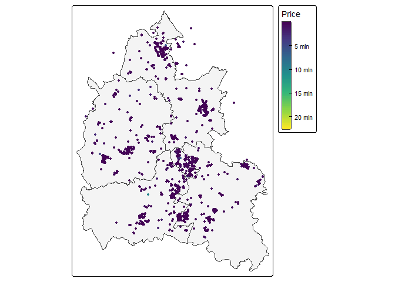
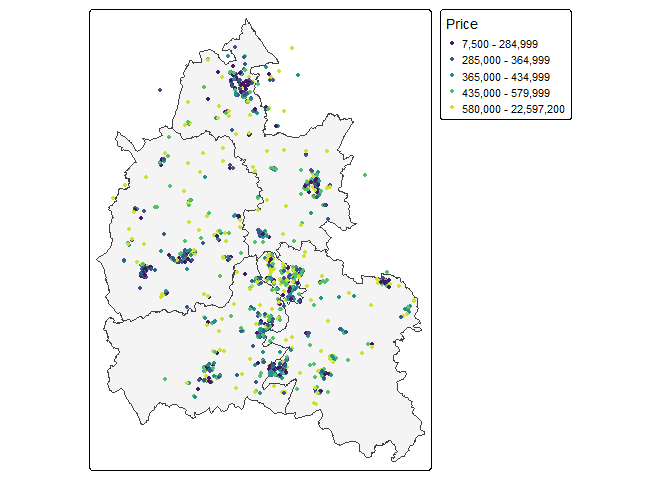
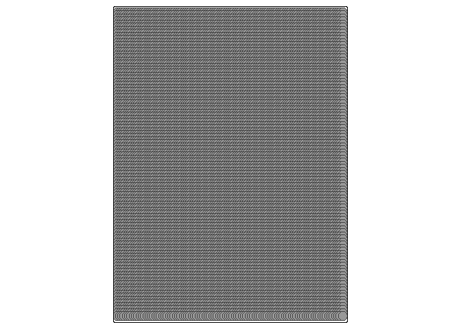
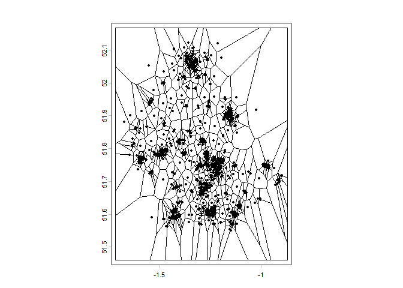
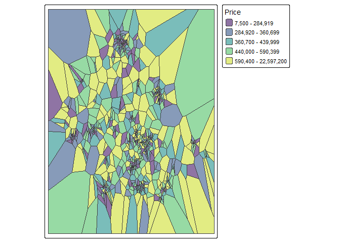
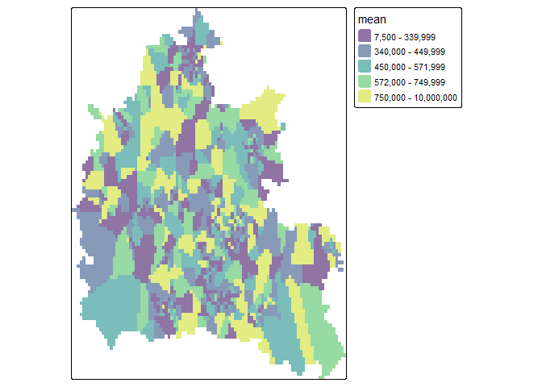
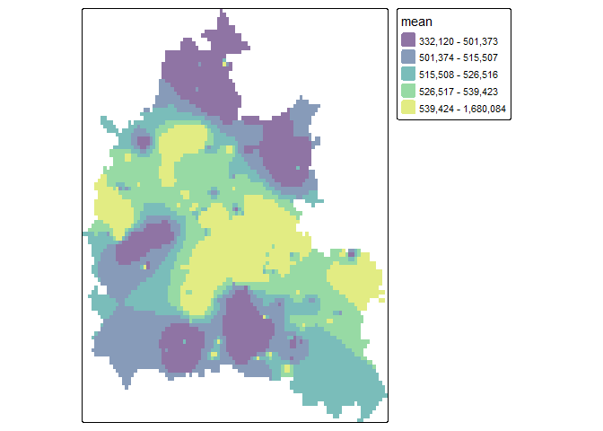
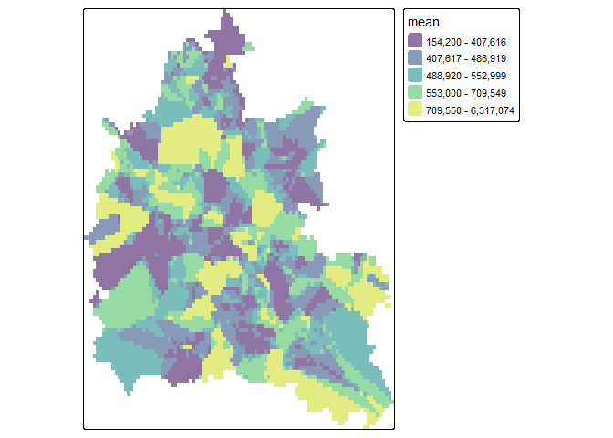
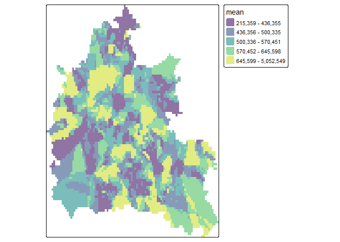

Practical 3: Spatial interpolation
================
Tin Hang (Henry) Hung

- [Your route through the 30
  minutes](#your-route-through-the-30-minutes)
- [Station 0 · Set up](#station-0--set-up)
  - [Packages and a helper function](#packages-and-a-helper-function)
  - [House prices as points](#house-prices-as-points)
  - [Oxfordshire districts](#oxfordshire-districts)
- [Station 1 · First look](#station-1--first-look)
- [Station 2 · Where to predict](#station-2--where-to-predict)
- [Station 3 · Closest observation (Voronoi
  polygons)](#station-3--closest-observation-voronoi-polygons)
- [Station 4 · IDW and nearest
  neighbours](#station-4--idw-and-nearest-neighbours)
  - [Inverse distance weighting (IDW)](#inverse-distance-weighting-idw)
  - [Nearest neighbours](#nearest-neighbours)
- [Station 5 · Ensemble](#station-5--ensemble)
- [Station 6 · Which method is best? Five-fold
  cross-validation](#station-6--which-method-is-best-five-fold-cross-validation)

Thinking of buying a house around Oxford? (*Disclaimer: I am not a
property agent and I am not selling one.*) We use HM Land Registry
[Price Paid
Data](https://www.gov.uk/government/statistical-data-sets/price-paid-data-downloads)
to map house prices and to predict them where no sale was recorded.

**Data** (in `data/`):

| File | Contents |
|----|----|
| `hp.csv` | 1,234 Oxfordshire sales (downloaded September 2025; mostly 2024-2025, a few back to 1997) |
| `LAD_DEC_24_UK_BGC/` | ONS Local Authority District boundaries, December 2024 (British National Grid) |

⌛ **30 minutes** · practical 3 of 5 in a 2-hour session

# Your route through the 30 minutes

| Station | Minutes | What you do | You leave with |
|----|----|----|----|
| **0** Set up | 0–4 | Packages, house prices, Oxfordshire boundaries, CRS | `hp` and `ox` in the same CRS |
| **1** First look | 4–7 | Map the sales, find the outliers | A map you can read |
| **2** Where to predict | 7–10 | A 100 × 100 grid, kept inside Oxfordshire | Prediction locations `coop` |
| **3** Closest observation | 10–14 | Voronoi polygons, spatial join, rasterise | Your first interpolated map |
| **4** IDW and nearest neighbours | 14–19 | Two `gstat` models | Two more maps |
| **5** Ensemble | 19–21 | Average the three methods | A fourth map |
| **6** Which method is best? | 21–30 | 5-fold cross-validation with RMSE | A winner |

Sections marked **+ optional** can be skipped if you are short of time.

# Station 0 · Set up

⏱️ **0–4 min**

## Packages and a helper function

``` r
# install.packages(c("gstat", "sf", "terra", "tmap"))   # tmap >= 4.0
library(gstat)   # IDW, nearest-neighbour interpolation (and kriging)
library(sf)
library(terra)
library(tmap)

# Root mean squared error, used for cross-validation below
RMSE <- function(observed, predicted) sqrt(mean((observed - predicted)^2, na.rm = TRUE))
```

## House prices as points

``` r
hp <- read.csv("data/hp.csv")
range(as.Date(hp$Date, format = "%d/%m/%Y"))   # which years are we mixing?
```

    ## [1] "1997-04-30" "2025-09-29"

``` r
hp <- st_as_sf(hp, coords = c("Longitude", "Latitude"), crs = 4326)
```

## Oxfordshire districts

``` r
lad <- st_read("data/LAD_DEC_24_UK_BGC/LAD_DEC_24_UK_BGC.shp", quiet = TRUE)
ox <- lad[lad$LAD24NM %in% c("Oxford", "Cherwell", "South Oxfordshire",
                             "Vale of White Horse", "West Oxfordshire"), ]
st_crs(ox)$Name   # OSGB36 / British National Grid
```

    ## [1] "OSGB36 / British National Grid"

We reproject `ox` to EPSG:4326 to match `hp`.

> For real analyses, staying in British National Grid (EPSG:27700) is
> better: Voronoi polygons and distances are then computed in metres
> rather than degrees, and at 51.7°N one degree of longitude is only
> about 0.62 of a degree of latitude on the ground. Here we practise
> reprojecting.

``` r
ox <- st_transform(ox, 4326)
```

> ✅ **EXPECT TO SEE:** `hp` has 1,234 sales; `ox` has 5 districts, now
> in EPSG:4326 like `hp`.

> 🎉 **MILESTONE!** Your sales and study area are in the same CRS.

# Station 1 · First look

⏱️ **4–7 min**

``` r
tmap_mode("plot")   # "view" gives an interactive map
tm_shape(ox) + tm_polygons(fill_alpha = 0.3) +
  tm_shape(hp) + tm_dots(fill = "Price",
                         fill.scale = tm_scale_continuous(values = "viridis"))
```

<!-- -->

**Question:** what looks wrong? How much do the most expensive sales
cost?

``` r
sort(hp$Price, decreasing = TRUE)[1:5]
```

    ## [1] 22597200 10000000  7933172  6168400  5900000

Colour by quantiles instead, so a few outliers do not squash the scale:

``` r
tm_shape(ox) + tm_polygons(fill_alpha = 0.3) +
  tm_shape(hp) + tm_dots(fill = "Price",
                         fill.scale = tm_scale_intervals(style = "quantile",
                                                         values = "viridis"))
```

<!-- -->

> 🤔 **THINK IT THROUGH:** what looks wrong on the first map?
>
> *Answer:* a few outliers (about £22.6 m, £10 m, £7.9 m, £6.2 m and
> £5.9 m, against a median of £400,000) squash the colour scale.

> 🎉 **MILESTONE!** You have seen why a quantile scale helps with skewed
> data.

# Station 2 · Where to predict

⏱️ **7–10 min**

We predict at the centres of a 100 × 100 raster grid covering
Oxfordshire.

``` r
grid <- rast(ox, nrows = 100, ncols = 100)   # empty raster over ox's bounding box
xy   <- xyFromCell(grid, 1:ncell(grid))       # matrix of cell-centre coordinates
head(xy)
```

    ##              x        y
    ## [1,] -1.715254 52.16493
    ## [2,] -1.706759 52.16493
    ## [3,] -1.698265 52.16493
    ## [4,] -1.689771 52.16493
    ## [5,] -1.681277 52.16493
    ## [6,] -1.672782 52.16493

``` r
coop <- st_as_sf(as.data.frame(xy), coords = c("x", "y"), crs = 4326)
qtm(coop, dots.size = 0.1)    # covers the whole rectangle...
```

<!-- -->

``` r
coop <- st_filter(coop, ox)   # ...so keep only points inside Oxfordshire
nrow(coop)
```

    ## [1] 5635

> ✅ **EXPECT TO SEE:** `xy` has 10,000 rows; after `st_filter()`,
> `coop` has about 5,635 points.

> 🎉 **MILESTONE!** You have prediction locations covering the study
> area.

# Station 3 · Closest observation (Voronoi polygons)

⏱️ **10–14 min**

Each prediction takes the price of the closest sale, i.e. of the Voronoi
polygon it falls in.

``` r
v <- voronoi(vect(hp), bnd = ox)
plot(v); points(vect(hp), cex = 0.5)
```

<!-- -->

``` r
v <- st_as_sf(v)
tm_shape(v) +
  tm_polygons(fill = "Price",
              fill.scale = tm_scale_intervals(style = "quantile", values = "viridis"),
              fill_alpha = 0.6, col = NA)
```

<!-- -->

> Several sales share a postcode centroid (identical coordinates), so
> the Voronoi diagram has fewer polygons than there are sales. How would
> you deal with that?

To map predictions on the grid, we attach each grid point to its Voronoi
polygon with a **spatial join**, then write the values into the raster.
`st_join()` keeps the rows in `coop`’s order and takes about a second
(`st_intersection(v, coop)` gives the same values but takes several
minutes).

``` r
v.resp <- st_join(coop, v["Price"])
v.pred <- rasterize(v.resp, grid, field = "Price", fun = "mean")
tm_shape(v.pred) +
  tm_raster(col.scale = tm_scale_intervals(style = "quantile", values = "viridis"),
            col_alpha = 0.6)
```

<!-- -->

> ✅ **EXPECT TO SEE:** About 1,020 Voronoi polygons for 1,234 sales,
> because 214 sales share a location with an earlier one.

> 🎉 **MILESTONE!** Every location in Oxfordshire now has a predicted
> price.

# Station 4 · IDW and nearest neighbours

⏱️ **14–19 min**

## Inverse distance weighting (IDW)

`gstat()` arguments: `formula = Price ~ 1` is an intercept-only model;
`nmax` is the number of nearest observations used (here all of them);
`set = list(idp = 1)` sets the inverse-distance power ($\beta$ in the
lecture; `gstat`’s default is 2).

``` r
idw <- gstat(formula = Price ~ 1, locations = hp,
             nmax = nrow(hp),            # use all sales
             set = list(idp = 1))        # beta = 1
idw.resp <- predict(idw, coop, debug.level = 0)   # columns var1.pred, var1.var

idw.pred <- rasterize(idw.resp, grid, field = "var1.pred", fun = "mean")
tm_shape(idw.pred) +
  tm_raster(col.scale = tm_scale_intervals(style = "quantile", values = "viridis"),
            col_alpha = 0.6)
```

<!-- -->

## Nearest neighbours

The average of the $k$ closest sales, all weighted equally: `idp = 0`,
`nmax = k`.

``` r
nb <- gstat(formula = Price ~ 1, locations = hp, nmax = 5, set = list(idp = 0))
nb.resp <- predict(nb, coop, debug.level = 0)

nb.pred <- rasterize(nb.resp, grid, field = "var1.pred", fun = "mean")
tm_shape(nb.pred) +
  tm_raster(col.scale = tm_scale_intervals(style = "quantile", values = "viridis"),
            col_alpha = 0.6)
```

<!-- -->

**Question:** how does the map change as you increase `nmax`? What
happens as `nmax` approaches the number of sales?

> ✅ **EXPECT TO SEE:** `idw.resp` and `nb.resp` each have 5,635 rows;
> the IDW map is much smoother than the Voronoi map.

> 🎉 **MILESTONE!** You can fit and map two distance-based interpolation
> models with `gstat`.

# Station 5 · Ensemble

⏱️ **19–21 min**

Equal weights (1/3 each). All three prediction vectors are in `coop`’s
row order, so they line up.

``` r
ens <- v.resp$Price * 1/3 + idw.resp$var1.pred * 1/3 + nb.resp$var1.pred * 1/3

ens.resp <- st_sf(pred = ens, geometry = st_geometry(coop))
ens.pred <- rasterize(ens.resp, grid, field = "pred", fun = "mean")
tm_shape(ens.pred) +
  tm_raster(col.scale = tm_scale_intervals(style = "quantile", values = "viridis"),
            col_alpha = 0.6)
```

<!-- -->

> 🎉 **MILESTONE!** You have four maps of predicted prices. Which one
> should you trust?

# Station 6 · Which method is best? Five-fold cross-validation

⏱️ **21–30 min**

We randomly assign each sale to one of $K = 5$ folds of roughly equal
size. For each fold we fit on the other four and predict the held-out
one. (`dismo::kfold()` does the same, but `dismo` is no longer actively
developed.) Setting a seed makes everyone’s folds identical.

``` r
set.seed(2025)
K  <- 5
kf <- sample(rep(1:K, length.out = nrow(hp)))   # a fold label (1-5) for each sale
table(kf)
```

    ## kf
    ##   1   2   3   4   5 
    ## 247 247 247 247 246

``` r
rmse <- data.frame(closest.obs = rep(NA, K), IDW = NA,
                   nearest.neigh = NA, ensemble = NA)

for (k in 1:K) {
  # Split into test (fold k) and training (all other folds)
  test  <- hp[kf == k, ]
  train <- hp[kf != k, ]

  # Closest observation: Voronoi of the training sales, bounded by Oxfordshire
  v <- st_as_sf(voronoi(x = vect(train), bnd = ox))
  v.pred <- st_join(test, v["Price"], suffix = c("", ".pred"))$Price.pred  # in test's row order

  # IDW (power 1, all training sales)
  idw.pred <- predict(gstat(formula = Price ~ 1, locations = train,
                            nmax = nrow(train), set = list(idp = 1)),
                      test, debug.level = 0)$var1.pred

  # Nearest neighbours (k = 5, equal weights)
  nb.pred <- predict(gstat(formula = Price ~ 1, locations = train,
                           nmax = 5, set = list(idp = 0)),
                     test, debug.level = 0)$var1.pred

  # Ensemble (equal weights)
  ens.pred <- v.pred * 1/3 + idw.pred * 1/3 + nb.pred * 1/3

  rmse[k, ] <- c(RMSE(test$Price, v.pred),  RMSE(test$Price, idw.pred),
                 RMSE(test$Price, nb.pred), RMSE(test$Price, ens.pred))
}

rmse
```

    ##   closest.obs       IDW nearest.neigh  ensemble
    ## 1    756478.4  676444.2      664356.3  679296.0
    ## 2    492359.7  476883.5      549940.9  477898.0
    ## 3   1562343.7  475168.1      813958.3  865099.2
    ## 4    701401.8  625809.3      591977.8  593413.7
    ## 5   1464151.2 1435455.6     1362932.0 1416072.3

``` r
colMeans(rmse)
```

    ##   closest.obs           IDW nearest.neigh      ensemble 
    ##      995347.0      737952.2      796633.1      806355.8

**Question:** which method has the lowest mean RMSE?

For context, here is the RMSE of a “model” that predicts the mean price
everywhere:

``` r
RMSE(hp$Price, mean(hp$Price))
```

    ## [1] 832791.9

**Discussion:**

- How much better than this baseline are the spatial methods?
- Prices are very skewed. Would RMSE on `log(Price)` tell a different
  story?
- Random folds put test sales right next to training sales. Would
  holding out whole areas (spatial block cross-validation) give a more
  honest estimate?
- Weighting the ensemble by inverse RMSE is a natural extension. Why
  must those weights be estimated on the training folds only?

> ✅ **EXPECT TO SEE:** Folds of 247, 247, 247, 247 and 246 sales. Mean
> RMSEs of about 995,000 (closest observation), 738,000 (IDW), 799,000
> (nearest neighbours) and 808,000 (ensemble), against about 833,000 for
> the mean price.

> 🎉 **MILESTONE!** You can compare interpolation methods by
> cross-validation.

------------------------------------------------------------------------

**Congratulations!** You can now interpolate a spatial variable with
several methods and compare them by cross-validation.
