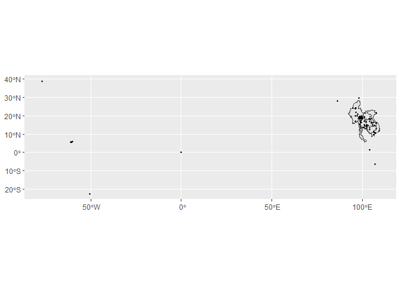
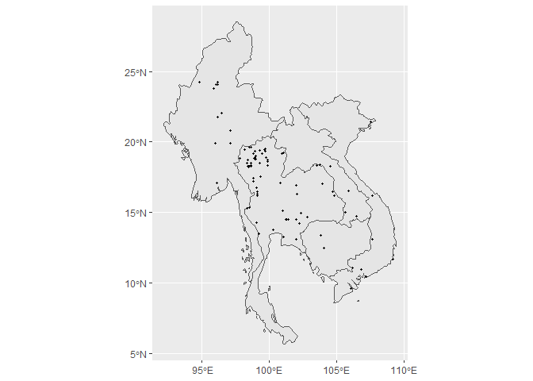
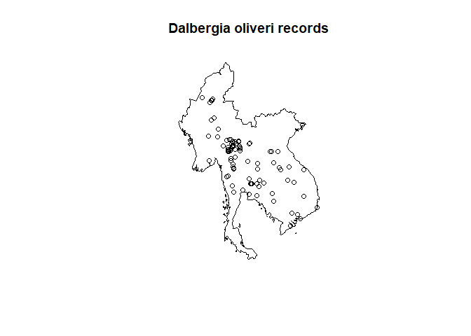
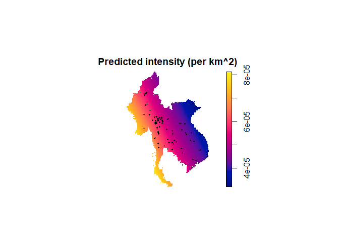
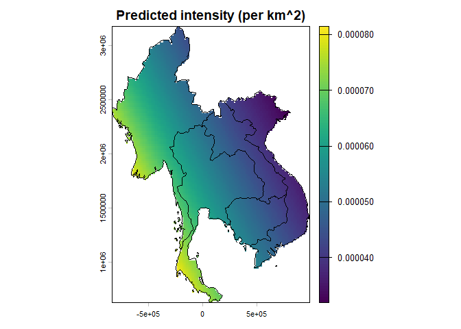
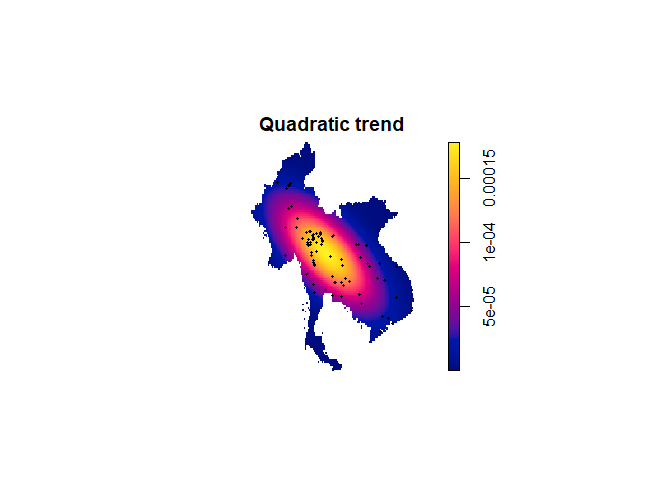

Practical 4: Species distribution modelling
================
Tin Hang (Henry) Hung

- [Your route through the 25
  minutes](#your-route-through-the-25-minutes)
- [Station 0 · Set up](#station-0--set-up)
  - [Packages](#packages)
  - [Occurrence data](#occurrence-data)
- [Station 1 · Clean the records](#station-1--clean-the-records)
- [Station 2 · Project to metres](#station-2--project-to-metres)
- [Station 3 · Point pattern](#station-3--point-pattern)
- [Station 4 · Fit and compare](#station-4--fit-and-compare)
  - [Homogeneous Poisson model (null
    model)](#homogeneous-poisson-model-null-model)
  - [Inhomogeneous Poisson model with a linear
    trend](#inhomogeneous-poisson-model-with-a-linear-trend)
  - [Compare with AIC](#compare-with-aic)
- [Station 5 · Predict](#station-5--predict)

Rosewoods are the most seized wildlife product by value: about 35% of
all wildlife seizures in 2005-2014, roughly double elephant ivory at 18%
([UNODC World Wildlife Crime Report
2016](https://data.opendevelopmentmekong.net/dataset/4bfe6854-b85c-4d75-87e5-8128181c3aa1/resource/2583469a-194b-405c-b239-8c01f2c73eaa/download/exsum_wildlife_report_2016.pdf)).
Southeast Asian rosewoods are among the most exploited. Here we model
the distribution of *Dalbergia oliveri* as a spatial point process.

The occurrence data are downloaded live from GBIF, so your numbers may
differ slightly from your neighbour’s if GBIF has been updated.

⌛ **25 minutes** · practical 4 of 5 in a 2-hour session

# Your route through the 25 minutes

| Station | Minutes | What you do | You leave with |
|----|----|----|----|
| **0** Set up | 0–5 | Packages, download records from GBIF | `occ.df`, a table of records |
| **1** Clean the records | 5–9 | Map them, remove the wrong ones | `do.clean` |
| **2** Project to metres | 9–12 | Choose a UTM zone and reproject | `seasia_proj`, `do_proj` |
| **3** Point pattern | 12–15 | Window, `ppp` object, test for CSR | `pp` |
| **4** Fit and compare | 15–19 | Homogeneous and log-linear Poisson models, AIC | Two fitted models |
| **5** Predict | 19–25 | Map the predicted intensity | Your first species distribution map |

Sections marked **+ optional** can be skipped if you are short of time.

# Station 0 · Set up

⏱️ **0–5 min**

## Packages

``` r
# install.packages(c("ggplot2", "rnaturalearth", "rnaturalearthdata",
#                    "sf", "spatstat", "spocc", "terra"))
library(ggplot2)
library(rnaturalearth)  # country boundaries
library(sf)
library(spatstat)       # point patterns: ppp(), ppm(), quadrat.test()
library(spocc)          # occurrence data from GBIF and other providers
library(terra)
```

## Occurrence data

[GBIF](https://www.gbif.org/) (Global Biodiversity Information Facility)
holds over 3 billion occurrence records.

``` r
# The default limit is only 500 records per provider; ask for more
occ.raw <- occ(query = "Dalbergia oliveri", from = "gbif",
               has_coords = TRUE, limit = 5000)
occ.df  <- occ2df(occ.raw)     # one row per record: name, longitude, latitude, prov, ...
nrow(occ.df)
```

    ## [1] 183

``` r
occ.df$longitude <- as.numeric(occ.df$longitude)   # make sure coordinates are numbers
occ.df$latitude  <- as.numeric(occ.df$latitude)
do <- st_as_sf(occ.df, coords = c("longitude", "latitude"), crs = 4326)
```

> ✅ **EXPECT TO SEE:** A data frame with one row per record. The data
> are live, so your count may differ slightly from your neighbour’s.

> 🎉 **MILESTONE!** You can pull occurrence data for any species from
> GBIF.

# Station 1 · Clean the records

⏱️ **5–9 min**

``` r
seasia <- ne_countries(country = c("Thailand", "Laos", "Cambodia", "Vietnam", "Myanmar"),
                       scale = "medium", returnclass = "sf")

ggplot() + geom_sf(data = seasia) + geom_sf(data = do, size = 0.8) + coord_sf()
```

<!-- -->

This looks odd: some records lie far outside the expected range. Keep
only records inside the five countries, and drop exact duplicates.

``` r
do.clean <- st_filter(do, seasia)
do.clean <- do.clean[!duplicated(st_coordinates(do.clean)), ]
nrow(do.clean)
```

    ## [1] 102

``` r
ggplot() + geom_sf(data = seasia) + geom_sf(data = do.clean, size = 0.8) + coord_sf()
```

<!-- -->

> GBIF records are **presence-only** and cluster where people collect
> (near roads, in protected areas, around herbaria). The pattern
> reflects both where the species lives and where people looked.

> 🎉 **MILESTONE!** You have a cleaned set of presence records.

# Station 2 · Project to metres

⏱️ **9–12 min**

Point-process models live in continuous space: intensity is “points per
unit **area**”, so distances and areas must be in metres, not degrees.

**Question:** which UTM zone covers most of the region, and what is its
EPSG code?

``` r
crs_proj <- 32648   # UTM zone 48N (102-108°E). Myanmar lies west of it, so an
                    # equal-area projection would distort areas less; UTM is fine here.
seasia_proj <- st_transform(seasia, crs_proj)
do_proj     <- st_transform(do.clean, crs_proj)
```

> 🎉 **MILESTONE!** Your records and study region are in metres.

# Station 3 · Point pattern

⏱️ **12–15 min**

`spatstat` needs a `ppp` object: point coordinates plus an observation
window (`owin`), here the union of the five countries.

``` r
w <- as.owin(st_union(seasia_proj))
do.coords <- st_coordinates(do_proj)

pp <- ppp(x = do.coords[, "X"], y = do.coords[, "Y"], window = w)
pp <- spatstat.geom::rescale(pp, 1000, "km")  # metres -> km, so intensity is per km^2
# (spatstat.geom:: is needed because terra also has a rescale() function)
plot(pp, main = "Dalbergia oliveri records")
```

<!-- -->

Is the pattern compatible with complete spatial randomness (CSR)?

``` r
quadrat.test(pp, nx = 5, ny = 5)
```

    ## 
    ##  Chi-squared test of CSR using quadrat counts
    ## 
    ## data:  pp
    ## X2 = 150.66, df = 19, p-value < 2.2e-16
    ## alternative hypothesis: two.sided
    ## 
    ## Quadrats: 20 tiles (irregular windows)

> ✅ **EXPECT TO SEE:** `pp` prints as a planar point pattern in a
> polygonal window, in km. Check the quadrat test’s p-value: are the
> records compatible with complete spatial randomness?

> 🎉 **MILESTONE!** You have turned species records into a point pattern
> `spatstat` can model.

# Station 4 · Fit and compare

⏱️ **15–19 min**

## Homogeneous Poisson model (null model)

Constant intensity everywhere.

``` r
fit0 <- ppm(pp ~ 1)
fit0
```

    ## Stationary Poisson process
    ## Fitted to point pattern dataset 'pp'
    ## Intensity: 5.292581e-05
    ##              Estimate       S.E.   CI95.lo   CI95.hi Ztest      Zval
    ## log(lambda) -9.846619 0.09901475 -10.04068 -9.652554   *** -99.44598

``` r
intensity(pp)   # the same estimate: number of points / area
```

    ## [1] 5.292581e-05

## Inhomogeneous Poisson model with a linear trend

$$\log\lambda(s) = \beta_0 + \beta_1 x(s) + \beta_2 y(s)$$

``` r
fit1 <- ppm(pp ~ x + y)
fit1
```

    ## Nonstationary Poisson process
    ## Fitted to point pattern dataset 'pp'
    ## 
    ## Log intensity:  ~x + y
    ## 
    ## Fitted trend coefficients:
    ##   (Intercept)             x             y 
    ## -9.3094493507 -0.0005268481 -0.0002619721 
    ## 
    ##                  Estimate         S.E.       CI95.lo       CI95.hi Ztest
    ## (Intercept) -9.3094493507 0.4399901977 -1.017181e+01 -8.447084e+00   ***
    ## x           -0.0005268481 0.0002626589 -1.041650e-03 -1.204614e-05     *
    ## y           -0.0002619721 0.0002194742 -6.921336e-04  1.681895e-04      
    ##                   Zval
    ## (Intercept) -21.158311
    ## x            -2.005826
    ## y            -1.193635

## Compare with AIC

Lower AIC means a better trade-off between fit and complexity.

``` r
AIC(fit0)
```

    ## [1] 2214.71

``` r
AIC(fit1)
```

    ## [1] 2214.473

> 🎉 **MILESTONE!** You can fit point process models and choose between
> them by AIC.

# Station 5 · Predict

⏱️ **19–25 min**

``` r
lambda.im <- predict(fit1, type = "trend")   # a spatstat pixel image, points per km^2
plot(lambda.im, main = "Predicted intensity (per km^2)")
plot(pp, add = TRUE, pch = 16, cex = 0.4)
```

<!-- -->

Convert to a `terra` raster (coordinates back to metres) to combine it
with other layers:

``` r
lambda.r <- rast(as.data.frame(lambda.im), type = "xyz")
# multiply the coordinates; ext(r) * 1000 would rescale the extent around its centre
ext(lambda.r) <- as.vector(ext(lambda.r)) * 1000   # km -> m
crs(lambda.r) <- paste0("EPSG:", crs_proj)
plot(lambda.r, main = "Predicted intensity (per km^2)")
plot(st_geometry(seasia_proj), add = TRUE)
```

<!-- -->

**Question:** is this what you expected? Why does the prediction look so
simple?

The model `~ x + y` can only produce a plane on the log scale, i.e. a
single gradient. For a more realistic surface we need meaningful
covariates (climate, elevation) or a more flexible form. **+ optional:**
try a quadratic trend:

``` r
fit.poly <- ppm(pp ~ polynom(x, y, 2))
AIC(fit.poly)
```

    ## [1] 2137.086

``` r
plot(predict(fit.poly, type = "trend"), main = "Quadratic trend")
plot(pp, add = TRUE, pch = 16, cex = 0.4)
```

<!-- -->

> 🎉 **MILESTONE!** You have mapped a species distribution as the
> intensity of a point process.

------------------------------------------------------------------------

**Next (Practical 5):** replace `x` and `y` with environmental
covariates, for example WorldClim layers from
`geodata::worldclim_country()`, passed to `ppm()` as `spatstat` images.
