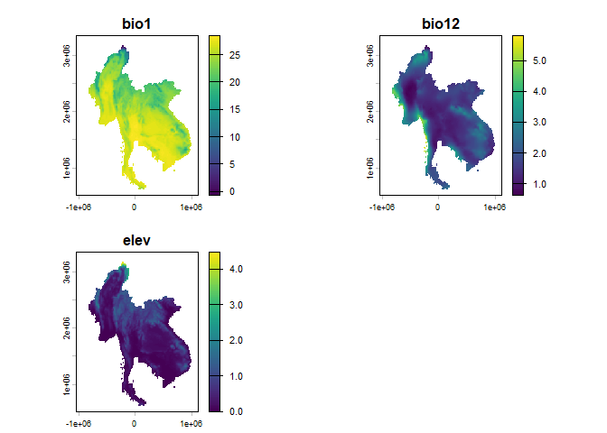
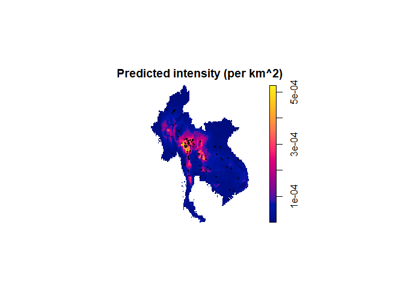

Practical 5: My mini-project
================
Tin Hang (Henry) Hung

- [Your route through the 15
  minutes](#your-route-through-the-15-minutes)
- [Station 0 · Recreate the point pattern from Practical
  4](#station-0--recreate-the-point-pattern-from-practical-4)
- [Station 1 · Find the covariates](#station-1--find-the-covariates)
- [Station 2 · Fit with covariates](#station-2--fit-with-covariates)
- [Station 3 · So what?](#station-3--so-what)

⌛ **15 minutes, then on your own** · practical 5 of 5 in a 2-hour
session

We continue Practical 4, but now use biologically meaningful
environmental variables, rather than the coordinates `x` and `y`, to
predict where *Dalbergia oliveri* occurs. This practical has little
guidance. Keep three questions in mind:

1.  Where can I get biologically meaningful variables such as
    temperature, precipitation and elevation?
2.  How can I include them as covariates in the Poisson process?
3.  With the new predicted distribution, what further spatial analyses
    would help conservation and management of this species?

The code below is **one** possible answer. Try it yourself first.

# Your route through the 15 minutes

| Station | Minutes | Question | You leave with |
|----|----|----|----|
| **0** Recreate the point pattern | before you start | Re-run Practical 4 | `pp`, in km |
| **1** Find the covariates | 0–5 | Where do I get climate and elevation layers? | Rasters in the same CRS as `pp` |
| **2** Fit with covariates | 5–12 | How do I put them in `ppm()`? | A model you can compare with `fit1` by AIC |
| **3** So what? | 12–15 | What would a conservation manager do with this map? | An idea to explore on your own |

# Station 0 · Recreate the point pattern from Practical 4

``` r
# install.packages(c("geodata", "rnaturalearth", "rnaturalearthdata",
#                    "sf", "spatstat", "spocc", "terra"))
library(geodata)        # WorldClim and elevation downloads
library(rnaturalearth)
library(sf)
library(spatstat)
library(spocc)
library(terra)
```

The same steps as Practical 4: download, clean, project to UTM zone 48N
and rescale to km.

``` r
occ.df <- occ2df(occ(query = "Dalbergia oliveri", from = "gbif",
                     has_coords = TRUE, limit = 5000))
occ.df$longitude <- as.numeric(occ.df$longitude)
occ.df$latitude  <- as.numeric(occ.df$latitude)
do <- st_as_sf(occ.df, coords = c("longitude", "latitude"), crs = 4326)

seasia <- ne_countries(country = c("Thailand", "Laos", "Cambodia", "Vietnam", "Myanmar"),
                       scale = "medium", returnclass = "sf")
do.clean <- st_filter(do, seasia)
do.clean <- do.clean[!duplicated(st_coordinates(do.clean)), ]

crs_proj    <- 32648                       # UTM zone 48N
seasia_proj <- st_transform(seasia, crs_proj)
do_proj     <- st_transform(do.clean, crs_proj)

w  <- as.owin(st_union(seasia_proj))
xy <- st_coordinates(do_proj)
pp <- ppp(xy[, "X"], xy[, "Y"], window = w)
pp <- spatstat.geom::rescale(pp, 1000, "km")  # metres -> km

fit1 <- ppm(pp ~ x + y)                       # the Practical 4 model, for comparison
pp
```

    ## Planar point pattern: 102 points
    ## window: polygonal boundary
    ## enclosing rectangle: [-838.0661, 983.2161] x [624.489, 3176.923] km

# Station 1 · Find the covariates

⏱️ **0–5 min**

<details>

<summary>

Hint
</summary>

`geodata` downloads WorldClim climate and elevation. The 10 arc-minute
global layers are small enough to download in class. Crop them to the
study region, then reproject them to the CRS of `pp` with
`terra::project()`.
</details>

``` r
# BIO1 = annual mean temperature (°C), BIO12 = annual precipitation (mm; converted to m below)
bio  <- worldclim_global(var = "bio", res = 10, path = "data")[[c(1, 12)]]
elev <- elevation_global(res = 10, path = "data")

env <- c(bio, elev)
names(env) <- c("bio1", "bio12", "elev")
env$bio12 <- env$bio12 / 1000   # mm -> m, keeps the squared term well scaled
env$elev  <- env$elev / 1000    # m -> km
env <- crop(env, ext(vect(seasia)) + 1)     # 1 degree margin

# Project to UTM 48N on a 10 km grid, and keep the five countries
env_proj <- project(env, paste0("EPSG:", crs_proj), res = 10000, method = "bilinear")
env_proj <- mask(env_proj, vect(seasia_proj))
plot(env_proj)
```

<!-- -->

> ✅ **EXPECT TO SEE:** three maps: temperature highest in the lowlands
> of Cambodia and central Thailand, rainfall highest along the coasts,
> and elevation highest in northern Myanmar and Laos.

# Station 2 · Fit with covariates

⏱️ **5–12 min**

<details>

<summary>

Hint
</summary>

`ppm()` takes covariates as `spatstat` pixel images (`im`). A projected
`terra` layer converts with `as.im(as.data.frame(layer, xy = TRUE))`.
Its coordinates must be in the same units as `pp` (km here).
</details>

``` r
to_im <- function(r) {
  df <- as.data.frame(r, xy = TRUE)
  df$x <- df$x / 1000; df$y <- df$y / 1000   # metres -> km, like pp
  as.im(df)
}
covs <- lapply(names(env_proj), function(v) to_im(env_proj[[v]]))
names(covs) <- names(env_proj)
```

``` r
fit.env <- ppm(pp ~ bio1 + bio12 + elev, covariates = covs)
fit.env
```

    ## Nonstationary Poisson process
    ## Fitted to point pattern dataset 'pp'
    ## 
    ## Log intensity:  ~bio1 + bio12 + elev
    ## 
    ## Fitted trend coefficients:
    ## (Intercept)        bio1       bio12        elev 
    ## -30.9034647   0.8063295  -0.8917795   5.5255081 
    ## 
    ##                Estimate      S.E.     CI95.lo     CI95.hi Ztest      Zval
    ## (Intercept) -30.9034647 4.9988440 -40.7010188 -21.1059106   *** -6.182122
    ## bio1          0.8063295 0.1733836   0.4665039   1.1461550   ***  4.650553
    ## bio12        -0.8917795 0.2680186  -1.4170864  -0.3664726   *** -3.327304
    ## elev          5.5255081 1.1159357   3.3383144   7.7127018   ***  4.951458

``` r
AIC(fit1)
```

    ## [1] 2214.473

``` r
AIC(fit.env)
```

    ## [1] 2137.541

A species usually has an optimum temperature and rainfall, not a
straight-line response, so try quadratic terms too:

``` r
fit.env2 <- ppm(pp ~ bio1 + I(bio1^2) + bio12 + I(bio12^2) + elev, covariates = covs)
AIC(fit.env2)
```

    ## [1] 2086.411

``` r
plot(predict(fit.env2, type = "trend"), main = "Predicted intensity (per km^2)")
plot(pp, add = TRUE, pch = 16, cex = 0.4)
```

<!-- -->

> ✅ **EXPECT TO SEE:** a predicted intensity that follows mountains,
> rivers and climate zones rather than one straight gradient, and a
> lower AIC than `fit1`.
>
> If a record falls in a cell with no climate value (for example on the
> coast), `ppm()` drops it with a warning. Warnings are hidden in this
> document (`warning = FALSE`), so run the chunk in the console to see
> them.

> 🎉 **MILESTONE!** You have a species distribution model driven by the
> environment.

# Station 3 · So what?

⏱️ **12–15 min**

> 🤔 **THINK IT THROUGH:** what could you do with the new map?
>
> *Some ideas:*
>
> - Overlay protected areas and ask how much of the predicted range they
>   cover.
> - Predict under a future climate scenario, for example with
>   `geodata::cmip6_world()`.
> - Check whether the records cluster near roads and cities. That would
>   point to sampling bias rather than habitat; a road-distance
>   covariate can absorb some of it.

Feel free to explore on your own and share what you find with me and the
demonstrators. You can also work on another species or any other kind of
spatial data.

------------------------------------------------------------------------

I might not have a chance to speak to every one of you in this course,
but thank you for being dedicated students. I hope this was both useful
and interesting. If it was not useful, well… at least you made some
maps.
